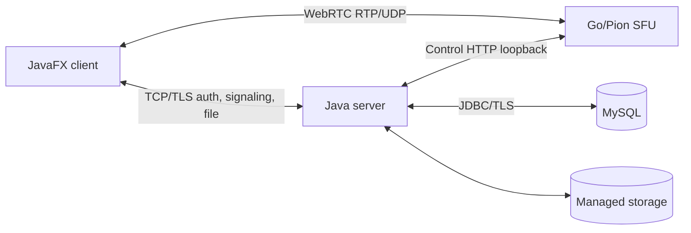

# Kiến trúc

## Các thành phần

| Thành phần | Trách nhiệm |
|---|---|
| JavaFX client | Giao diện, quyền thiết bị, trạng thái phòng và thu/phát media |
| Java server | Xác thực, phân quyền, quản lý phòng, chat, tệp và điều phối SFU |
| Go/Pion SFU | Kết nối WebRTC và chuyển tiếp RTP theo subscription |
| MySQL | Tài khoản/OTP/phiên, thông tin phòng, lịch sử và metadata tệp |
| Storage server | Nội dung tệp và dữ liệu upload tạm do server quản lý |

Control HTTP SFU chỉ bind loopback, mặc định 127.0.0.1:8766. Nó không phải
cổng video để mở cho người dùng. WebRTC dùng ICE và UDP IPv4.

## Phòng và dữ liệu

Server là nguồn quyết định quyền thành viên, host, duyệt thành viên, khóa phòng
và generation. `server.meeting.RoomService` điều phối phòng live;
`RoomRepository`/`RoomRoutineClient` xử lý dữ liệu bền vững.

`server.rooms.RoomService`, `LegacyRoomService` và giao thức phòng cũ vẫn giữ
vai trò tương thích với quản lý phòng/tệp. Không phải hai bản service dư có
thể xóa thay thế tùy ý. Phòng mới từ giao diện chính đi qua signaling.

Sảnh nhận snapshot và push thay đổi. Chat phòng live dùng server push, lưu RAM
có giới hạn; không xem `Tin_Nhan` là cơ chế lưu bền vững của mọi tin chat live.
Bảng này còn phục vụ đường chat tương thích và metadata tệp.

Đóng cả phòng kích hoạt cleanup trên server, giữ thông tin phòng/lịch sử,
dọn nội dung và chặn mở lại tới khi xác minh hoàn tất. Rời phòng riêng lẻ
hoặc mất mạng ngắn không đồng nghĩa đóng phòng. Việc cho download chạy tiếp
sau đóng phòng không phải chính sách hiện tại.

## Media

Client thu hình/âm thanh; SFU chuyển tiếp, client nhận và giải mã. Chỉ subscribe
video đang hiển thị: một video chính và tối đa năm thumbnail. Thu nhỏ giao diện
không tự tạo một lớp mã hóa bitrate thấp riêng.

Trạng thái nguồn media dùng push snapshot có revision/generation. Khi tắt,
nguồn thu dừng; kết nối mic/camera có thể được giữ tối đa 30 giây và bị thu hồi
sớm khi cần tài nguyên. Các lane nhận media tách khỏi điều khiển bật/tắt.
Xác thực server vẫn được giữ; không áp dụng auth cache mới hoặc trickle ICE.

AUTO video dùng thống kê WebRTC tại client, giảm video trước khi ảnh hưởng thoại.
Không ghi telemetry định kỳ vào MySQL. Phục hồi signaling có grace hai phút;
sau phục hồi, việc phát lại thiết bị cần thao tác người dùng.
