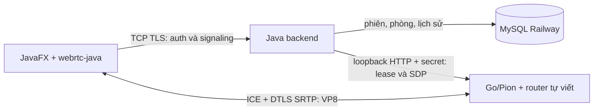
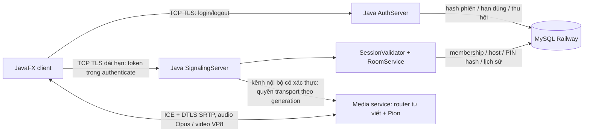

# Kiến trúc SFU — phòng, signaling và video

Ngày khảo sát: 14/10/2026. Base commit: `30039612adb101b07858cf808f7cc008aeb26adf`.

**Quyết định runtime: JavaFX và backend Java giữ auth/room/signaling; Go/Pion chịu transport media và router SFU tự viết.** Người dùng đã giao quyền chọn phương án phù hợp. Mốc 0 và phòng/signaling Mốc 1 đã có bằng chứng thực thi. Theo yêu cầu mới nhất, bước tiếp theo chỉ triển khai video; voice chat và screenshare để sau. Dependency `webrtc-java:0.19.0` đã nằm trong runtime client. Ba client native trao đổi nguồn video tạo sẵn qua engine thật và render JavaFX; chưa nghiệm thu camera vật lý hay mạng LAN/Internet. Xem [video-call.md](video-call.md) và [sfu-testing.md](sfu-testing.md).

## Mốc 1 sau khi ghép code

Mốc 1 có session validation, RoomService/Repository và TCP/TLS 8444. `MeetingServerMain` giữ auth/phòng/truyền tệp của đồng đội và thêm signaling trong cùng JVM. Form tạo/join có sẵn hiện dùng signaling cho phòng mới rồi vào PreJoinScreen/MeetingScreen; không cần nút SFU riêng. Snapshot chứa RoomInfo do server tạo để FilePanel dùng cùng ID database và membership. LIST_ROOMS đọc cả phòng signaling; kênh auth vẫn chặn GET/JOIN/LEAVE trên các phòng có marker `MMR_Phong_Van_Hanh` để không có hai chủ sở hữu membership. VideoCoordinator nối quyền phòng với Go bằng lease tối đa 15 giây; publish/subscribe/stop/state kiểm tra phiên và membership. Không thêm schema cho video.

## Luồng video hiện đã tích hợp

MeetingSession sở hữu VideoCallController; view chỉ mượn mailbox/binding. Pre-join có track xem trước cục bộ; vào MeetingScreen mới dựng PC publish nếu người dùng đã bật camera. Chuyển view chỉ gỡ binding, giữ capture owner. Client có một PC gửi camera và một PC nhận cho mỗi nguồn khác; full ICE gathering, client offer owner, không renegotiate cùng PC. Go giữ publication/lease/route trong RAM, forward codec payload với queue riêng từng receiver, RTCP keyframe qua worker riêng. Java quản lý child process và shutdown. Callback native giữ/release frame đúng vòng đời, chuyển I420 sang RGB ngoài FX thread; mailbox hữu hạn cập nhật ảnh tối đa 10 lần/giây. Thiết bị chỉ mở sau thao tác bật camera. Logout/leave/kick thu hồi quyền; mất kết nối không tự bật camera lại. Chi tiết giới hạn trong [video-call.md](video-call.md).

## Hiện trạng lúc khảo sát Mốc 0

| Thành phần | Trạng thái thực tế |
|---|---|
| AuthServer/AuthClient/AuthService | Đăng ký, đăng nhập, đăng xuất thật qua TCP/TLS và MySQL Railway |
| Phiên | Token opaque 32 byte ngẫu nhiên; DB lưu SHA-256 Base64URL, hạn dùng và thu hồi; chưa có API validate cho signaling |
| SceneManager | Giữ user/token trong RAM, chưa giữ `expiresAt`; `hasSession()` không kiểm tra quyền trên server |
| server.sfu/signaling/room, client.webrtc/signaling/room | Class khung trống |
| Lobby/CreateRoom/PreJoin/Meeting/VideoTile | Phòng, PIN, membership, thiết bị, preview, microphone level và media giả lập |
| NetworkStatsDialog | Thông số ngẫu nhiên có nhãn mô phỏng; không dùng làm bằng chứng media |
| Diagnostics | Logger thật cho auth/JVM; không có media production được đo |

Schema Railway đã được kiểm tra metadata chỉ đọc bằng `InspectMeetingSchema`: bốn bảng có đủ cột/PK/unique/FK cần khảo sát, `missing_or_incompatible=0`. Không đọc row, không áp dụng migration; CHECK/ENUM/defaults chưa được công cụ này kiểm chứng. Chi tiết ở tài liệu kiểm thử.

Không có `AGENTS.md` trong repository hoặc thư mục cha đã kiểm tra. Chỉ có `docs/sfu-build-prompt.md` là file chưa track trước khi bắt đầu; giữ nguyên file đó và không sửa bản demo trong Downloads.

## Dependency ứng viên đã xác minh

- Client: `dev.onvoid.webrtc:webrtc-java:0.19.0`, native classifier `windows-x86_64`. Maven Central có JAR Java và JAR native; profile platform của dependency chọn Windows amd64. Không dùng `latest`/snapshot. Pinned tag upstream: [`v0.19.0`](https://github.com/devopvoid/webrtc-java/tree/v0.19.0), commit `d2b5a8ad7ec407417bc455c668f4efbf8144480e`.
- Java API upstream build base release 8 và module metadata 9; project build release 21. Việc native tương thích phải được kiểm chứng trên JVM thực tế, không suy từ số release. Máy hiện tại chạy JDK 22.0.2; chưa xác nhận chạy trên đúng JDK 21.
- Wrapper có Apache-2.0; native bundle chứa WebRTC BSD-3-Clause và nhiều dependency riêng, gồm FFmpeg LGPL-2.1-or-later theo [`NOTICE`](https://github.com/devopvoid/webrtc-java/blob/v0.19.0/NOTICE). Khi phân phối phải giữ NOTICE/licenses, không gọi toàn bộ binary là chỉ Apache-2.0. Probe không thêm module `webrtc-java-media`.
- Build lại JNI cần Visual Studio/Windows SDK và toolchain WebRTC, tải source khoảng 20 GB theo [build guide pinned](https://github.com/devopvoid/webrtc-java/blob/v0.19.0/docs/guide/build.md). Dùng binary Maven tránh yêu cầu build native cho probe này.

Thư viện xử lý ICE, DTLS/SRTP, RTP packetization/depacketization, codec và stats của **endpoint client**. Project tự viết harness nguồn I420/PCM, thứ tự SDP/ICE, kiểm tra kết quả, deadline và cleanup. Harness nối hai endpoint trực tiếp để kiểm chứng client, chưa phải router SFU hay signaling sản phẩm.

## Vì sao chưa chọn wrapper làm SFU

0.19.0 có encoded transforms; không được mô tả nhầm là chỉ có frame đã decode. [`RTCEncodedFrameTransformer`](https://github.com/devopvoid/webrtc-java/blob/v0.19.0/webrtc/src/main/java/dev/onvoid/webrtc/RTCEncodedFrameTransformer.java) chạy sau encode/trước packetizer ở sender, sau depacketizer/trước decoder ở receiver. Có thể đọc/thay payload/drop của frame đang được callback và yêu cầu keyframe.

Tuy nhiên, API công khai đã kiểm tra ở [`RTCRtpReceiver`](https://github.com/devopvoid/webrtc-java/blob/v0.19.0/webrtc/src/main/java/dev/onvoid/webrtc/RTCRtpReceiver.java), [`RTCRtpSender`](https://github.com/devopvoid/webrtc-java/blob/v0.19.0/webrtc/src/main/java/dev/onvoid/webrtc/RTCRtpSender.java), [`RTCPeerConnection`](https://github.com/devopvoid/webrtc-java/blob/v0.19.0/webrtc/src/main/java/dev/onvoid/webrtc/RTCPeerConnection.java) không cung cấp callback/reader RTP packet, writer RTP packet hay reader/writer RTCP tùy ý để router thực hiện yêu cầu trong prompt. [`RTCEncodedFrame`](https://github.com/devopvoid/webrtc-java/blob/v0.19.0/webrtc/src/main/java/dev/onvoid/webrtc/RTCEncodedFrame.java) không có constructor công khai để inject độc lập frame vào sender; metadata SSRC/PT/timestamp không có setter. Buffer transform chỉ hợp lệ trong callback; không được đưa native buffer đó sang queue bất đồng bộ.

Đây là giới hạn của **API phiên bản đã khảo sát**, không phải khẳng định mọi giải pháp Java đều bất khả thi. Nối VideoTrack/AudioTrack đã decode sang sender khác sẽ transcode; thay payload của frame do encoder giả tạo cũng chưa chứng minh RTP/RTCP mapping và quyền điều khiển cần thiết. Không dùng các cách đó để đánh dấu cổng SFU đã đạt.

## Runtime đã chọn và chi phí tích hợp

Giữ JavaFX + auth/room/signaling Java/MySQL, thêm **media service riêng bằng Go/Pion**, tự viết router. Engine pin [`github.com/pion/webrtc/v4 v4.2.23`](https://github.com/pion/webrtc/tree/v4.2.23), MIT. [go.mod pinned](https://github.com/pion/webrtc/blob/v4.2.23/go.mod) yêu cầu Go tối thiểu 1.24.0. Toolchain kiểm chứng pin **Go 1.27.2 Windows amd64** trong `.tools/`, checksum tải từ `go.dev`; script không cài hệ thống hay đổi PATH. `go.sum` sẽ giữ các dependency tải thực tế.

Source Pion có [`TrackRemote.ReadRTP`](https://github.com/pion/webrtc/blob/v4.2.23/track_remote.go), [`TrackLocalStaticRTP.WriteRTP`](https://github.com/pion/webrtc/blob/v4.2.23/track_local_static.go), [`PeerConnection.WriteRTCP`](https://github.com/pion/webrtc/blob/v4.2.23/peerconnection.go). API đó phù hợp thử đường packet đã encode qua các transport riêng. `WriteRTP` ánh xạ SSRC/PT theo binding; extension MID/RID/TWCC, sequence continuity, feedback/cache/drop vẫn cần project thiết kế/test, không sao chép mù header hay SRTP. Pion là thư viện transport, không phải SFU hoàn chỉnh.

Chi phí: thêm một toolchain build và một `.exe`/tiến trình server; quản lý health/shutdown, kênh điều khiển backend–media có xác thực, stats/CPU/RSS ngoài JVM, port UDP/firewall/NAT/TURN. Không cần Docker. Java backend vẫn sở hữu Railway credentials; media service không nhận password DB hoặc token login client.

Lựa chọn giữ một JVM cần tự làm JNI packet bridge hoặc kiểm chứng engine Java tầng thấp khác. Native bridge tăng chi phí toolchain/build/buffer ownership, duy trì patch và phân phối binary. Chưa triển khai lựa chọn này.

Việc chọn runtime đáp ứng mục 3.6 của [prompt](sfu-build-prompt.md). Đường chuyển tiếp qua engine đã chạy thành công ở cổng Mốc 0 với một publisher/một subscriber; kết quả này cho phép bắt đầu Mốc 1 theo thứ tự, chưa nghiệm thu Mốc 2–4.

## Thiết kế ban đầu Mốc 0 (lưu để đối chiếu)

Phần dưới mô tả kế hoạch tại thời điểm khảo sát; hiện trạng video ở mục trên và `video-call.md` thay thế những nhận xét “chưa triển khai” bên dưới. Audio, screenshare, reconnect/ICE restart và tải dài hạn vẫn chưa được nghiệm thu.

Đề xuất TCP/TLS framing riêng cho signaling vì client là Java desktop và đã có certificate/hostname validation. Không giữ kết nối dài trên auth worker. Protocol có version/requestId, 128 KiB/message ban đầu cần test SDP, giới hạn rate/queue, opaque room/participant/track IDs, generation và heartbeat. Đây là thiết kế dự kiến, chưa có endpoint lắng nghe.

Đề xuất một PeerConnection publish và một subscribe/client để tách negotiation hai hướng; tất cả remote media nối SFU. Một lớp chất lượng/track, Opus/VP8 trước; chưa hỗ trợ simulcast/SVC. Router tự viết chịu trách nhiệm quyền theo phòng, track registry/subscription, queue hữu hạn cho từng subscriber, ưu tiên audio, drop video/keyframe recovery, feedback mapping và cleanup. Pion chịu transport/security và packet I/O; chỉ bật feedback/extensions đã thương lượng và kiểm thử.

## Chủ sở hữu và vòng đời dự kiến

- MeetingSession sở hữu capture, transport, track, scheduler và device selection; PreJoin/MeetingScreen chỉ mượn binding. `SceneManager.show()` luôn dispose màn cũ, nên transition preview → meeting không được đóng MeetingSession.
- Mỗi VideoTile chỉ sở hữu render binding và frame mới nhất. `MeetingScreen.renderVideos()` hiện dựng lại tile; dispose tile không được dispose remote track dùng chung. Frame thay thế được release; UI update có giới hạn và chỉ trên JavaFX thread.
- Java server sở hữu live membership và generation; DB lưu lịch sử, không truy vấn mỗi packet. Schema có membership lịch sử, không thêm unique `(room,user)` làm mất khả năng tái tham gia.
- Đề xuất một tài khoản/room có một live participant; client thứ hai bị từ chối. Host rời thì đóng phòng ở MVP. Restart đóng live room cũ và ghi leave reason; không hồi sinh quyền transport từ membership lịch sử.
- Validate phiên lúc authenticate/join/publish/subscribe, định kỳ tối đa 5 giây và invalidation trực tiếp khi logout cùng server; đo revocation latency. Hết hạn/thu hồi đóng quyền media, không tự bật capture lại khi reconnect. Chính sách này chưa triển khai/test.
- Close idempotent: vô hiệu generation → dừng feeder/capture/timer → đóng track/subscription/cache/transport → release frame/buffer → join worker → đóng logger ở owner tiến trình. Không dùng frame đã release trong callback đến muộn.

## Diagnostics

Giữ `mmr.diagnostics.v1` và một logger owner/tiến trình. Adapter chỉ gửi metric/code cố định, dùng ID số cục bộ, không dump stats/SDP/ICE/địa chỉ/identity. Bộ lọc logger không thay thế kiểm soát đầu vào adapter. `MediaSample` cần delta, RTP payload byte và RTT/jitter ms; bỏ cửa sổ reset/loss bị hiệu chỉnh, giữ `null` khi không đo được. SFU không decode nên không có FPS decode/freeze server.

`MMR_DIAGNOSTICS_ENABLED=false` tắt logger; routing tương lai không phụ thuộc logger. Có thể tháo adapter bằng no-op sink. Probe và công cụ đọc log không sửa logger schema hoặc nới string allowlist. Xem [diagnostics.md](diagnostics.md).
