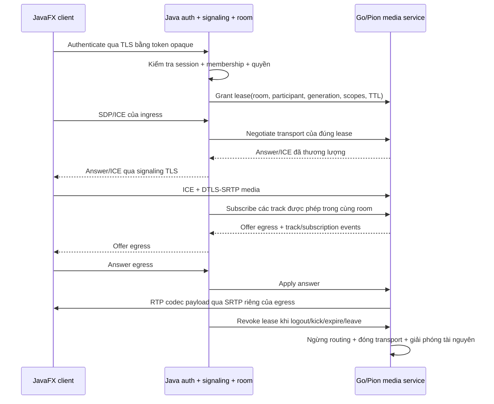

# Hợp đồng Java backend ↔ media service Go/Pion

Trạng thái: đây là thiết kế mở rộng ban đầu. MVP video đã triển khai theo [video-call.md](video-call.md), dùng control `/v1/control` và PC riêng cho từng publication; không coi toàn bộ endpoint/lease 30 giây trong tài liệu này đã triển khai. Mốc 0 đã
chứng minh Java publisher → Pion ingress → Pion egress → Java subscriber với
Opus/VP8 và RTP codec payload không đổi. `/publish`, `/subscribe`, `/stats`,
`/session` của `media/probe` là API của bài thử; không đưa trực tiếp vào luồng họp.
Chỉ triển khai hợp đồng này sau khi test auth/phòng/signaling Mốc 1 đã đạt.

Runtime đã chọn: Java 21/JavaFX cho giao diện và backend; Go/Pion cho transport
media và router tự viết. Dependency đã kiểm chứng ở Mốc 0:
`dev.onvoid.webrtc:webrtc-java:0.19.0` + `windows-x86_64` ở Java và
`github.com/pion/webrtc/v4 v4.2.23` ở Go. Đóng băng phiên bản cùng `go.sum`, không
đổi engine giữa các bài so sánh. Mốc 0 chạy trên JDK thực tế của máy, chưa tự suy
ra đã kiểm thử runtime JDK 21 chỉ vì Maven compile release 21.

## Ranh giới quyền và dữ liệu

Java `SessionValidator` kiểm tra token opaque do auth cấp dựa trên hash, expiry,
revocation và trạng thái tài khoản. Java `RoomService` quyết định room membership,
host, capacity, khóa phòng, quyền publish/subscribe và quyền mời người ra. Go không
kết nối Railway, không nhận mật khẩu DB, token login hoặc PIN và không tin role
do client gửi. Go chỉ thi hành media lease mà Java cấp qua kênh điều khiển nội bộ.



Control HTTP bind loopback trên cùng máy với backend. Dùng secret service riêng,
ngẫu nhiên tối thiểu 256 bit trong `MMR_MEDIA_CONTROL_SECRET`, header
`X-MMR-Media-Key`; so sánh constant time, không đưa vào URL/log/config tracked.
Đây là credential process-to-process, không cấp cho client. Nếu tách hai process
sang hai máy, phải dùng TLS xác minh hostname/SAN và cơ chế authenticate riêng
(ưu tiên mTLS); không công bố HTTP nội bộ ra Internet.

Mỗi process media có `engine_instance` ngẫu nhiên khi khởi động. Backend ghi nhận
instance từ health; instance đổi làm vô hiệu toàn bộ transport cũ. Những giá trị
này là định danh điều khiển, không phải tên người dùng hoặc quyền truy cập.

## Envelope và xử lý request

API version `1`; mỗi mutation nhận body:

```json
{
  "version": 1,
  "request_id": "opaque-request-id",
  "engine_instance": "opaque-engine-instance",
  "participant_generation": 1,
  "payload": {}
}
```

`payload` chứa DTO riêng của từng endpoint. Ví dụ grant lease có `room_id`,
`participant_id`, `ttl_ms`, `publish_kinds` và `allowed_subscriptions`; offer có
`sdp_type` và `sdp`; ICE có `candidate`, `sdp_mid`, `sdp_mline_index`. Response chứa
`version`, `request_id`, status hoặc
`code` cố định và result DTO. Không trả lỗi native nguyên văn. ID room,
participant, lease, transport, track, subscription do server cấp; giới hạn 64 ký
tự ASCII an toàn, không dùng display name làm khóa. Generation tăng khi reconnect
tạo phiên media mới; Go từ chối generation/instance cũ trước khi chạm transport.

Giới hạn ban đầu: JSON 128 KiB; SDP nằm trong giới hạn đó; ICE candidate DTO tối
đa 2 KiB/candidate, queue trước remote description tối đa 128 candidate/transport.
Control timeout 5 giây, negotiation/gather deadline 10 giây, mutation rate 20/s
với burst 40 cho mỗi lease. HTTP header tối đa 4 KiB. Các con số là cấu hình ban
đầu cần kiểm thử; không tăng vô hạn khi có SDP lỗi.

`request_id` dedup theo engine instance + lease + operation. Cache tối đa 1024
result, tuổi 120 giây, từng result tối đa 128 KiB; vượt budget trả lỗi hữu hạn.
Cùng ID với payload khác trả `REQUEST_CONFLICT`. Retry create/grant/subscribe phải
trả lại cùng tài nguyên; DELETE của tài nguyên đã đóng trả success idempotent.
Go không giữ global lock khi gather ICE hoặc chờ I/O; lock riêng theo participant
và generation giữ mutation cùng transport tuần tự.

## Lease do Java sở hữu

`POST /v1/leases` cấp một lease với `room_id`, `participant_id`, generation,
`ttl_ms`, `publish_kinds`, `allowed_subscriptions` và giới hạn track/bitrate. Scope
publish ban đầu là audio, camera-video; screenshare thêm ở Mốc 3. Không cấp wildcard
cross-room. Lease chỉ do Java đã kiểm tra membership tạo được.

TTL tối đa 30 giây, Java renew mỗi 10 giây sau khi kiểm tra quyền còn hiệu lực.
`ttl_ms` không vượt thời gian sống còn lại của auth session. Go dùng monotonic
deadline từ thời điểm nhận grant/renew; không dùng hai đồng hồ chưa đồng bộ để đo
network latency. Go ngừng routing và đóng transport khi hết lease dù backend mất
kết nối. Backend có thể cache SessionValidator tối đa 5 giây; logout/kick có push
invalidation ngay và phải đo revoke-to-media-stop thực tế.

`PATCH /v1/leases/{lease_id}` renew TTL hoặc giảm scopes; không được âm thầm tăng
generation hoặc đổi room/participant. Thay generation phải revoke cũ rồi grant mới.
`DELETE /v1/leases/{lease_id}` revoke, dừng đọc/gửi RTP và xóa subscription của lease
trước khi trả ACK cleanup. Java có thể yêu cầu trạng thái nếu timeout; Go không
cho grant lại cùng generation trong lúc cleanup chưa xong.

Host yêu cầu force-unpublish/kick qua Java signaling. Java kiểm tra host rồi giảm
scope/revoke trên Go và thông báo native client dừng publication/capture. Host
không có thao tác bật camera/microphone từ xa. Mute của client cập nhật desired
state và dừng publication tương ứng; chỉ thay icon hoặc gửi black/silence liên tục
không đủ để nghiệm thu yêu cầu dừng dữ liệu.

## Transport và SDP/ICE

MVP dùng hai PeerConnection cho mỗi participant: ingress dành cho các track do
participant publish, egress dành cho những track được subscribe. Một video track
có một lớp chất lượng; audio Opus, video VP8. Local preview không đi vòng qua SFU.

| Operation | Result và điều kiện |
| --- | --- |
| `POST /v1/leases/{id}/transports` | Tạo role `ingress` hoặc `egress`, tối đa một role/lease generation. Trả opaque transport ID. |
| `POST /v1/transports/{id}/offer` | Client là offer owner của ingress; server áp dụng offer rồi tạo answer. |
| `POST /v1/transports/{id}/answer` | Client trả answer cho offer egress do media service tạo. |
| `POST /v1/transports/{id}/ice` | Candidate DTO đã xác minh lease/generation; buffer hữu hạn nếu chưa có remote description. |
| `DELETE /v1/transports/{id}` | Đóng role và tài nguyên phụ thuộc, ACK sau cleanup có deadline. |

Ingress chỉ có client tạo offer, egress chỉ có server tạo offer. Backend chuyển
SDP/ICE qua signaling TLS và serialize negotiation theo transport generation.
Một offer egress đang chờ answer thì thay đổi subscriptions mới được gộp trong
hàng đợi hữu hạn; không tạo offer collision. Timeout/failure bỏ generation cũ và
thực hiện reconnect với generation mới. Không áp dụng SDP/ICE muộn vào transport
đã đóng. ICE restart chỉ công bố khi engine/client test thật hỗ trợ; Mốc 2 có thể
dùng transport mới thay vì hứa restart chưa kiểm chứng.

Client không liên hệ control HTTP của Go. Quyền WebRTC bắt nguồn từ lease và SDP
được Java duyệt, ICE credentials và DTLS fingerprint thương lượng cho transport
cụ thể. Không dùng trust-all hoặc tắt fingerprint validation.

## Publication và subscription

`POST /v1/leases/{id}/publications` khai báo opaque track ID, kind, transport và
negotiated media identifier; Go kiểm tra kind nằm trong publish scopes trước khi
bind inbound RTP. Mỗi lease tối đa một audio và một camera track ở Mốc 2; không
chấp nhận vô hạn m-line hoặc track mới mà chưa được Java cho phép. OnTrack chưa
được grant sẽ không được route. Publication chỉ ACTIVE sau negotiation và engine
xác nhận nguồn; sự kiện first RTP riêng để đo khi có dữ liệu.

`DELETE /v1/publications/{track_id}` unpublish, xóa các subscription/cache/timer
phụ thuộc rồi gửi event. Publish trở lại sau unpublish có track ID/generation mới
để không dùng nhầm RTP/cache của nguồn cũ. Track từ publisher đã rời phòng không
còn trong danh sách chọn nhận.

`POST /v1/leases/{id}/subscriptions` nhận target track ID. Go kiểm tra cả publisher
và subscriber lease đang sống trong cùng room, publisher vẫn ACTIVE và subscriber
được cấp scope đúng track. Không cho self-subscribe. Outbound track tạo binding
riêng cho transport subscriber; ACK chứa subscription ID và yêu cầu renegotiation
nếu cần. `DELETE /v1/subscriptions/{id}` hủy idempotent. Người vào muộn có thể nhận
các track đang publish và tạo PLI upstream sau khi egress ready.

`PATCH /v1/leases/{id}/media-state` chỉ giảm/dừng media theo quyền hiện có; trạng
thái phải đồng bộ về Java và các client. Không nhận role hay display name trong
operation làm căn cứ cấp quyền.

## Packet forwarding và feedback

Pion nhận SRTP, thực hiện decrypt/authentication transport và trả RTP encoded
codec payload. Router tự viết chọn subscriber và đẩy packet vào queue riêng.
Pion binding đích rewrite SSRC/PT và tạo SRTP mới. Không codec decode/encode tại
SFU; không sao chép gói SRTP hoặc toàn bộ RTCP giữa các transport.

Một publication generation có một SSRC nguồn. Trong Mốc 2, sequence/timestamp/
marker được giữ cho cùng nguồn; wraparound/reorder/duplicate không làm thay đổi
codec payload. MID/RID/TWCC/CSRC và extension ID từ ingress không được sao chép mù.
Egress dùng negotiated IDs và các extension do chính transport/interceptor đích
tạo được. Không thêm extension chưa thương lượng. Nếu sau này chuyển nguồn/lớp,
phải thêm mapping/rewrite và test discontinuity, chưa tái sử dụng mã probe như
bằng chứng hỗ trợ nguồn/lớp thay đổi.

RTCP SR/RR và NACK thuộc từng transport, dùng Pion interceptors có cấu hình cố định
đã xác minh. Subscriber PLI/FIR được chuyển thành PLI đến SSRC publisher đúng
generation, coalesce theo track tối đa một lần/500 ms. NACK cache, retransmission,
RTX, pacing và congestion feedback phải ghi rõ cơ chế thực sự bật/negotiated;
không công bố RTX/simulcast/SVC hay adaptive quality trước test tương ứng. Mốc 2
chưa chuyển lớp video; mỗi subscriber chỉ có thể giảm nhận/bỏ video, ưu tiên audio.

## Queue, ownership và teardown

Mỗi subscription có writer độc lập: tối đa 256 packet, 2 MiB gồm RTP header +
payload, tuổi tối đa 750 ms. Không chờ subscriber trong read loop publisher. Queue
đầy/packet quá tuổi thì drop có đếm, video yêu cầu keyframe recovery; audio không
bị chặn bởi queue video. Đây là policy đầu tiên cần đo, không phải năng lực tải đã
kiểm chứng. Giới hạn Pion interceptor cache và socket/native buffers phải kiểm
chứng riêng; không gọi giới hạn queue tự viết là giới hạn toàn bộ process memory.

Packet payload được copy khi đưa vào queue; queue sở hữu bản copy tới writer. Chỉ
chia sẻ immutable buffer/refcount khi có test ownership an toàn. Lifecycle owners:

| Owner | Tài nguyên |
| --- | --- |
| Java application/session | Token trong RAM, signaling connection, desired device state, client media session. |
| Java RoomService | Membership và quyền; DB history không làm media membership sống. |
| Go lease generation | Hai PC, publication/subscription, worker/timer/cache, pending SDP/ICE. |
| Go publication | Ingress reader, source SSRC mapping, PLI coalescer. |
| Go subscription | Outbound binding, queue và writer, RTCP reader. |
| Native Java media owner | Factory, ADM, local sources/tracks/senders, borrowed remote track lifetime, render latest-frame holder. |

Revoke/leave/shutdown có một completion được chia sẻ bởi mọi lần close. Dừng
admission, đóng ingress, drain queue đã nhận với deadline tối đa 2 giây, đóng
egress để unblock writer/RTCP, cancel/join workers tối đa 3 giây, xóa queue/cache/
timer/mapping. Trả explicit cleanup timeout/error khi vượt deadline; không báo
success chỉ vì đã set closed flag. Go process restart làm mất media grants, Java
giữ room policy và yêu cầu reconnect generation mới sau authenticate lại.

## Events, đo đạc và nghiệm thu

Backend poll `GET /v1/events?after=cursor` hoặc stream có backpressure; event ring
ban đầu 1024 item, event DTO tối đa 4 KiB. Cursor quá cũ trả `RESYNC_REQUIRED` rồi
backend đọc snapshot; không bỏ sự kiện revoke vì queue đầy. Event types cố định:
transport state, publication/subscription state, lease expired/revoked, cleanup
completed/failed. Event chứa instance + generation, không chứa SDP/ICE/identity.

`GET /v1/stats` cung cấp cumulative counters có định nghĩa: RTP payload bytes,
packet counts, queue packets/bytes/age/drop, PLI/NACK/retransmission khi đo được,
active resource counts và forward processing/wait duration. Java adapter lấy delta
theo cửa sổ monotonic, bỏ window counter reset hoặc loss adjustment không hợp lệ.
Không log từng packet/frame hoặc suy ra one-way latency từ đồng hồ hai process.
SFU không có decode FPS/freeze metric. Native/client render drop tách decoder drop.

Mỗi process có diagnostics owner riêng, run ID dùng chung và correlation ID ngẫu
nhiên trong phạm vi bài thử. Không log token/lease secret/PIN/password/SDP/ICE/raw
network address/user name/audio/video. Hash payload chỉ dùng assertion với nguồn
deterministic trong test, không log hoặc bật cho media thiết bị thật. RSS/process
CPU của Go tách JVM heap/client native memory; giá trị thiếu là null, không gán 0.

Trước khi tích hợp UI thật, test service bằng hai rồi ba native client, kiểm tra
cross-room, self-subscribe, generation cũ, revoke/expire, bounded queues, late
join/keyframe, một client rời, cleanup sau nhiều vòng. Nguồn tự tạo không gọi là
test thiết bị thật. Camera/microphone/screenshare chỉ bật qua hành động chủ động
trong JavaFX. Long call, load/network impairment và Internet thuộc các mốc sau.

Nguồn API kiểm chứng:

- [Pion v4.2.23 ReadRTP](https://github.com/pion/webrtc/blob/v4.2.23/track_remote.go)
- [Pion v4.2.23 WriteRTP/binding](https://github.com/pion/webrtc/blob/v4.2.23/track_local_static.go)
- [Pion default interceptors/logger options](https://github.com/pion/webrtc/blob/v4.2.23/interceptor.go)
- [webrtc-java v0.19.0](https://github.com/devopvoid/webrtc-java/tree/v0.19.0)
